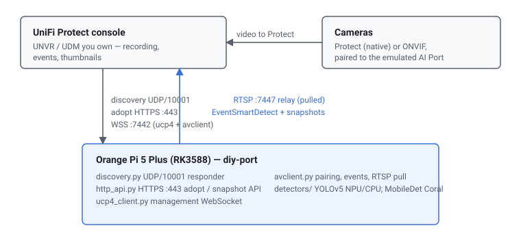

# pi-port — a DIY UniFi Protect "AI Port" (Orange Pi · Raspberry Pi · x86 · Mac)

<div align="center">

<a href="LICENSE"></a>
<a href="https://github.com/hutchx86/pi-port/actions/workflows/ci.yml"></a>

**A reverse-engineering / interoperability proof of concept that makes a stock
SBC or PC present itself to a real UniFi Protect console as genuine AI Port
hardware (catalog model `UVC AI Port`, sysid `0xa5f1`).**
**It speaks the vendor wire protocol only — discovery, adoption, camera pairing,
video relay, pluggable object detection and detection events with thumbnails —
with no firmware modification, no controller database writes and no Ubiquiti
code or binaries.**

</div>

> [!WARNING]
> Proof of concept, not production software. It binds privileged ports
> (UDP/10001, TCP/443) and manages macvlan interfaces and DHCP leases;
> misconfiguration can disrupt your network or device. Use it only on hardware
> and consoles you own. See [Disclaimer](#disclaimer).

> [!NOTE]
> Not affiliated with, endorsed by, or connected to Ubiquiti Inc. "UniFi",
> "UniFi Protect" and "AI Port" are trademarks of Ubiquiti Inc. No Ubiquiti
> firmware or binaries are distributed here. Built with AI assistance under
> human review — verify anything you rely on. See [Legal](#legal).

## Quick start

```bash
git clone https://github.com/hutchx86/pi-port && cd pi-port

# Orange Pi 5 Plus (RK3588, NPU):
sudo scripts/install.sh --console <console-ip> [--parent-iface <iface>]

# Raspberry Pi 5 + Coral, or any Linux CPU host (bare metal):
sudo scripts/install.sh --console <console-ip> --accel edgetpu   # or cpu
# (Pi 5 install.sh path is untested against a console; Docker bridge is verified)

# x86_64 / Raspberry Pi 4/5 with Docker:
AIPORT_CONSOLE_HOST=<console-ip> docker compose up -d --build

# Apple-silicon Mac, bare metal (Docker Desktop can't do L2 discovery):
# see "macOS (bare metal)" below

# ...or the console runs on the same host as Docker: see docker/README.md

# then adopt "AI Port" in Protect and pair a camera to it
```

## At a glance

|  |  |
| --- | --- |
| **What** | Emulates the UniFi Protect AI Port device role |
| **Hardware** | Orange Pi 5 Plus (RK3588 NPU) — verified live; Raspberry Pi 5 + Coral (Docker bridge) — verified; x86_64 + Raspberry Pi 4/5 (CPU, Docker); Apple-silicon Mac (bare metal) |
| **Protocol / interface** | UBNT discovery UDP/10001; mTLS WSS :7442 (`ucp4` + classic avclient); RTSP relay :7447; ONVIF video push to :7550 |
| **Detection** | Pluggable COCO detectors: RKNN (RK3588 NPU), Edge TPU (Coral), or `onnxruntime` on CPU/Core ML |
| **Language** | Python 3 |
| **License** | AGPL-3.0-or-later |

## How it compares

|  | Real AI Port | Pi Port |
| --- | --- | --- |
| **What it is** | Ubiquiti AI Port appliance (Ambarella) | This repo's Python, on an SBC/PC |
| **Firmware** | Ubiquiti, signed | None — the emulator itself |
| **Detection model** | Ubiquiti's own classifier | Stock COCO model mapped to person/vehicle/animal: YOLOv5 on the RK3588 NPU, SSDLite MobileDet on a Coral, or YOLOv5n on CPU/Core ML |
| **Output** | Full Ubiquiti product behaviour | The subset this project implements |

It is a protocol-compatible stand-in built on the same shared camera/chime
middleware, not a clone of the device.

## How it works

The host answers the console's L2 discovery, then adopts like a classic camera
(`POST /api/1.2/manage` on HTTPS :443). It keeps two mTLS WebSocket connections
to the console — the generic `ucp4` channel for management RPCs, and the classic
avclient channel for camera pairing and detection events. When a camera is
paired, the console hands the host an RTSP URL on its own internal relay
(`:7447`); the host pulls that stream, runs the configured detector, and pushes
`EventSmartDetect` events and snapshot uploads back to the console.

An assigned third-party (ONVIF) camera is handled the other way round: Protect
stops ingesting it and asks the AI Port to push its video to `tcp://<console>:7550`
as `extendedFlv`, while the AI Port also pulls the camera's RTSP for detection.



| Component | Role |
| --- | --- |
| `discovery.py` | UDP/10001 UBNT discovery responder |
| `http_api.py` | HTTPS :443 adopt / control / snapshot API |
| `ucp4_client.py` | Generic `ucp4` device-management WebSocket |
| `avclient.py` | Pairing, streaming and smart-detect WebSocket + detection loop |
| `detectors/` | Pluggable detector backends: `rknn` NPU, `edgetpu` Coral, `cpu` (onnxruntime/Core ML) |
| `onvif_push.py` | ONVIF camera video push to Protect (`extendedFlv`) |
| `sysinfo_server.py` | Dev-box CPU/mem/GPU/NPU/Coral status page (`webui.html`) |
| `instance_manager.py`, `run_all.py` | Multi-instance orchestration |

## Supported hardware

| Model | SoC / variant | Status | Notes |
| --- | --- | --- | --- |
| Orange Pi 5 Plus | RK3588 | Verified | Target board; NPU; 4 cameras have been paired and streamed live |
| Other RK3588 boards | RK3588 | Untested | The NPU and ffmpeg paths are RK3588-specific |
| Raspberry Pi 5 + Coral USB | BCM2712 + Edge TPU | Verified (Docker bridge) | Adoption, a UniFi camera and a 4K ONVIF camera with MobileDet detection (~33 ms/frame on USB 2); `install.sh` path untested against a console; no H.264 hardware decoder |
| Raspberry Pi 4 | BCM2711 | Verified | `docker/` image; H.264 hardware decode bare-metal only |
| x86_64 server / PC | amd64 | Verified | `docker/` CPU image; no NPU |
| Apple-silicon Mac | M-series | Verified | Bare metal only (Docker Desktop has no LAN L2); Core ML on the Neural Engine |
| Any Linux CPU host | `onnxruntime` | Untested | `--accel cpu`; fine for a camera or two |

The detector is pluggable (`piport/detectors/`, `[hardware] detector` in
`aiport.cfg`): `rknn`, `edgetpu`, `cpu`, or `auto`, which takes the first one
whose runtime, hardware and model are present. A new accelerator is a
`base.Detector` subclass registered in `BACKENDS` (and `AUTO_ORDER` for `auto`)
in `piport/detectors/__init__.py`.

## Features

- **Emulated AI Port device role** — L2 discovery, adoption, and both WebSocket
  connections a real console expects.
- **Camera pairing and video relay** — pairs real cameras and pulls their stream
  from Protect's internal RTSP relay.
- **Third-party (ONVIF) cameras** — pushes their video to Protect for live view
  and recording, and runs detection on the same stream.
- **Pluggable real object detection** — RKNN on the RK3588 NPU, SSDLite
  MobileDet (or a YOLOv5 Edge TPU export) on a Coral, and onnxruntime on CPU or
  the Apple-silicon Neural Engine (Core ML).
- **Detection events with thumbnails** — `EventSmartDetect` with per-object
  snapshots and Full-FoV images, plus the overview/timeline thumbnails.
- **Multi-instance** — one reboot-surviving systemd unit and macvlan interface
  per instance on the board, or one container per host. Board/macvlan instances
  are distinct L2 devices; a host-network container shares the host's IP. A
  small web UI manages the board's instances.
- **Honest state handling** — reflects real adopted state and clears local state
  on the console's reset.

## Requirements

- An Orange Pi 5 Plus (RK3588) with root and `rknn-toolkit-lite2` for NPU
  inference; **or** a Linux host (Raspberry Pi 5 + Coral, x86_64, Pi 4/5) for
  the Edge TPU or CPU path; **or** an Apple-silicon Mac bare metal for the
  Core ML/CPU path.
- The backend's runtime: `rknn-toolkit-lite2` (NPU), `ai-edge-litert` +
  `libedgetpu` (Coral), or `onnxruntime` (CPU/Core ML). `install.sh` installs
  only the selected backend; Docker builds it into the image.
- A UniFi Protect console you own and control, on the same LAN (except the
  same-host Docker bridge setup).
- For model conversion: an x86_64 Linux host with `rknn-toolkit2` (the RKNN
  converter does not run on the board).

## Repository layout

```
piport/               the emulator
  discovery.py          UDP/10001 UBNT discovery responder
  http_api.py           HTTPS :443 adopt/control API
  ucp4_client.py        generic ucp4 device-management websocket
  avclient.py           pairing/streaming/smart-detect websocket + detection
  detectors/            pluggable detector backends (rknn / edgetpu / cpu)
  onvif_push.py         ONVIF camera video push (extendedFlv)
  sysinfo_server.py     dev-box CPU/mem/GPU/NPU/Coral status page (+ webui.html)
  models/               anchors + COCO labels (model binaries fetched, not stored)
  instance_manager.py / run_all.py   multi-instance orchestration
compose.yaml          CPU stack / Komodo Stack (host net; x86_64 + arm64)
compose.macvlan.yaml  same, but a dedicated LAN IP/MAC per container
docker/               Dockerfile (CPU/Coral), bridge compose, smoke test + notes
scripts/              install.sh (board installer), fetch_models.py, helpers
rknn_convert/         YOLOv5s -> RKNN conversion recipe (x86 build host)
docs/images/          README diagram
```

Model binaries (`.onnx`/`.rknn`/`.tflite`) and all Ubiquiti firmware are **not**
stored here; see [Model assets](#model-assets-not-tracked). `piport/README.md`
has the protocol detail and per-component notes.

## Install / Usage

### Orange Pi 5 Plus (RK3588)

`scripts/install.sh` does the whole stand-up on the board: system packages, a
venv + dependencies, model assets, the required `librknnrt.so` upgrade, a
reboot-surviving systemd instance (via `instance_manager.py`), and the web UI.

```bash
sudo scripts/install.sh --console <UNVR-IP> [--parent-iface <iface>]
```

- Run from the checkout root, as root. `--parent-iface` defaults to the
  auto-detected default-route NIC.
- `--accel auto|rknn|edgetpu|cpu|none` picks the detector backend (default
  `auto`: rknn on an RK3588, edgetpu when a Coral is present, else cpu) and
  installs only that backend's runtime and model. `--no-npu` is an alias for
  `--accel none`.
- The NPU model cannot be built on the Pi; build it on an x86 host
  (`scripts/fetch_models.py --convert`) or let the installer fetch it from
  `--rknn-url` / `PIPORT_RKNN_URL` / its default URL. `--rknn <path>` takes a
  local build, and a local `models-rknn/` copy (e.g. a checkout of
  `hutchx86/pi-port-models`) is also detected.
- Opens the web UI on `:8090` (`--webui-port` to change) for board stats and
  instance management. Instance create/destroy is localhost-only by default;
  set `AIPORT_WEBUI_ALLOW_REMOTE=1` in the unit to allow it from the LAN.

Then, in Protect: adopt "AI Port" like any camera, and pair a real camera to it
from the camera's own settings page. Detections appear as dashboard events with
thumbnails, and the console's own person/vehicle/animal filters work.

`run_all.py` needs root (binds UDP/10001 and TCP/443) and must be able to send L2
broadcast/multicast on the LAN, so run it on the host, not in a NAT'd container
(exception: the same-host bridge setup below, where the console reaches the
container IP directly).
It resolves its own interface's IP by default, so multiple instances on one box
don't collide on `:443`.

### Raspberry Pi 5 + Coral (bare metal)

`install.sh --accel edgetpu` installs `ai-edge-litert`, feranick's maintained
`libedgetpu1-std` build (sha256-pinned per distro) and Google's SSDLite MobileDet
model, then writes `[hardware] detector = edgetpu`:

```bash
sudo scripts/install.sh --console <console-ip> --accel edgetpu
```

- Only the USB Coral is handled; a PCIe/M.2 Coral additionally needs the
  `gasket`/`apex` kernel driver, which the installer does not set up.
- The Pi 5 has no H.264 hardware decoder, so camera streams are decoded in
  software for detection (~half a core for 4K at 12 fps).
- Plug the Coral into a USB 3 port if you have one free; USB 2 works
  (~33 ms/frame for MobileDet, far below the 1.5 s detection tick).

For the same Pi 5 running the console in Docker, use the bridge setup instead
(see [Docker (console on the same host)](#docker-console-on-the-same-host)).

### x86 / Raspberry Pi (CPU Docker) and Komodo

`docker/` builds one image for `linux/amd64` and `linux/arm64` (Pi 4/5); the
detector backend is selected at build time (`ACCEL=cpu` by default, or
`edgetpu`). The repo-root `compose.yaml` is the single-instance stack (host
networking) and the **Komodo** Stack file:

```bash
docker build -f docker/Dockerfile -t piport-cpu .
AIPORT_CONSOLE_HOST=<console-ip> docker compose up -d --build
./docker/run-smoke-test.sh   # no console/camera needed
```

`compose.yaml` uses host networking (one instance per host: it shares the host's
`:443`/`UDP-10001`); `compose.macvlan.yaml` gives each container its own LAN
IP/MAC for several instances on one host. See [`docker/README.md`](docker/README.md)
for Komodo import, networking caveats, and the confirmed/untested matrix.

### Raspberry Pi (bare metal, optional)

The Docker stack above is the recommended Pi path and is the same command as
x86. Run bare metal only if you want the Pi 4's hardware H.264 decode (it stalls
inside a container) or no Docker. Differences from the RK3588 board: **no NPU**,
so install `onnxruntime` instead of `rknn-toolkit-lite2`, and there is **no
`.rknn`** — the CPU `yolov5n.onnx` is used.

```bash
sudo apt-get install -y ffmpeg python3-venv
python3 -m venv venv
venv/bin/pip install -r piport/requirements.txt onnxruntime
python3 scripts/fetch_models.py --backend cpu    # downloads yolov5n.onnx
$EDITOR piport/aiport.cfg                        # set [console] host (+ identity)
sudo venv/bin/python piport/run_all.py --iface <iface> [--state-dir <dir>]
```

`detectors/__init__.py` selects onnxruntime automatically. On a **Pi 4**,
`avclient.py` also enables `h264_v4l2m2m` hardware decode; on a **Pi 5** it does
not (no H.264 hardware decoder — it software-decodes, which the faster CPU
handles). For reboot survival, wrap `run_all.py` in a systemd unit with
`KillMode=control-group`:

```ini
[Unit]
Description=UniFi AI Port emulator
After=network-online.target
Wants=network-online.target
[Service]
Type=simple
ExecStart=/opt/pi-port/venv/bin/python /opt/pi-port/piport/run_all.py --iface <iface> --state-dir /var/lib/pi-port
Restart=on-failure
KillMode=control-group
[Install]
WantedBy=multi-user.target
```

### macOS (bare metal)

Verified on an Apple-silicon Mac (M1 Pro): adopted by a Protect console, 3 cameras
paired and streamed, person/vehicle detections with thumbnails. Run it on the host —
Docker Desktop's Linux VM can't put a container on the LAN as its own L2 device, so
discovery and adoption fail there. With no `/sys`, `/proc` or `ip`, `config.py` finds
the interface, MAC and IP through `route`, `networksetup` and `ifconfig` (`--iface en0`
to pick one explicitly). The detector uses onnxruntime's Core ML provider on the
Neural Engine by default: ~6.5 ms vs ~37 ms per frame on CPU (M1 Pro, `yolov5n`),
with the same detections; float32 models such as YOLOv9 run on Core ML's
NeuralNetwork format (~3 ms, M2). `AIPORT_ORT_PROVIDER=cpu` forces CPU; `coreml` requests
it (and warns, then uses CPU, if onnxruntime has no Core ML provider).

```bash
brew install ffmpeg
python3 -m venv venv
venv/bin/pip install -r piport/requirements.txt onnxruntime
venv/bin/pip install fast-alpr opencv-python-headless      # optional: plates + faces (enrich.py)
venv/bin/python scripts/fetch_models.py --backend cpu      # downloads yolov5n.onnx
venv/bin/python scripts/fetch_models.py --face-models-only # optional: YuNet/SFace face models
$EDITOR piport/aiport.cfg                                   # set [console] host + device_id
sudo caffeinate -is venv/bin/python piport/run_all.py --iface en0 --state-dir ~/.piport-state
```

`sudo` is needed for UDP/10001 and TCP/443.

- `caffeinate -is` stops the Mac sleeping while it runs (a sleeping Mac drops off the console).
- `--iface` is the default-route interface (`route -n get default`); the MAC is derived from it,
  so each Mac gets its own.
- **Every AI Port needs its own, stable `device_id`.** The default in `aiport.cfg` is shared, so on
  a second machine set a fresh one once (e.g. `uuidgen | tr A-Z a-z`) in `aiport.cfg`, or pass the
  same `--device-id` on every start; changing it makes Protect see a different device.
- A new machine (empty `--state-dir`) appears in Protect as a new "AI Port": adopt it and pair
  cameras to it. Adoption state lives in the state dir, so keep it across restarts.
- Without the optional enrichment packages it runs person/vehicle/animal only; plate models
  download to `~/.cache` on the first plate read.

### Docker (console on the same host)

When the Protect console itself runs in a container on the same box (for example
`dciancu/unifi-protect-unvr-docker-arm64` with `network_mode: host`), host
networking clashes on `:443` and a macvlan interface cannot talk to its own
host. `docker/docker-compose.yml` instead puts the AI Port on a private bridge
network: it gets its own `:443`, and host ↔ container traffic is routed without
NAT, so the console reaches it at `AIPORT_IP`.

```bash
cd docker
echo "AIPORT_CONSOLE=<console-ip>" > .env
docker compose up -d --build
```

The default backend is Coral (`AIPORT_ACCEL=edgetpu`); set `AIPORT_ACCEL=cpu`
or `none` to build a CPU image instead. Device identity and state persist in the
`aiport-data` volume. The trade-off: the AI Port lives on the Docker subnet
(default `172.30.10.0/24`), so only that host can reach it. See
[`docker/README.md`](docker/README.md).

### Manual install

```bash
python3 scripts/fetch_models.py --backend cpu    # or --backend edgetpu / rknn assets
pip install -r piport/requirements.txt           # + rknn-toolkit-lite2 / ai-edge-litert / onnxruntime
$EDITOR piport/aiport.cfg                        # identity, console IP, [hardware] detector
sudo python3 piport/run_all.py --iface <iface>
```

### Multiple instances (board)

`instance_manager.py` creates one systemd unit per instance, each with its own
macvlan sub-interface, MAC, and DHCP lease — a distinct L2 device:

```bash
sudo python3 piport/instance_manager.py create lab2 --parent-iface <iface>
python3 piport/instance_manager.py list
sudo python3 piport/instance_manager.py destroy lab2
```

### ONVIF cameras

Assigning a third-party (ONVIF) camera to the AI Port hands that camera's video
ingest to the AI Port: Protect sends the camera's RTSP URL (`OnvifStreamControl`)
and asks for each channel to be pushed to `tcp://<console>:7550` in Ubiquiti's
`extendedFlv` format (`ChangeVideoSettings`). `piport/onvif_push.py` does that
with one `ffmpeg -c:v copy` per channel (no re-encode), and the AI Port runs
detection on the camera's stream like on a UniFi camera's.

Verified on a Raspberry Pi 5 (Docker, Coral) with a Hikvision 4K camera and
Protect 7.2: live view in the app and browser, recording, and smart-detect
events.

Limits:

- **If the AI Port stops, the camera stops recording.** Protect no longer pulls
  it; unassign the camera (or remove the AI Port) to hand ingest back.
- **H.264 only.** Video is copied, not re-encoded. An H.265/HEVC camera is muxed
  by ffmpeg as Enhanced RTMP (an `hvc1` FourCC), which Protect's `ms` does not
  ingest: live view resets and the push is closed after a few hundred bytes,
  retried every second. Set the camera's stream to H.264. UniFi's own HEVC
  framing (FLV codec id 8 with a `0x68 0x01` VPS/SPS/PPS tag) is not
  implemented; such a stream is now refused with one clear error.
- Every channel carries the camera's main stream (no lower-resolution
  channels); the resolution reported to Protect is probed from the stream.
- Audio is AAC 32 kHz mono (silent if the camera has none). Protect asks for
  Opus, which plain FLV cannot carry.
- Each channel and the detector open their own RTSP session to the camera; some
  cameras limit concurrent logins (Hikvision answers `401` past its limit).
- On a Pi 5 the camera's H.264 is decoded in software for detection (~half a
  core for 4K at 12 fps).

### Model assets (not tracked)

Each backend needs an open model. Because the binaries are large and
reproducible, they are not committed; `scripts/fetch_models.py` downloads them
(`--backend rknn|edgetpu|cpu`), sha256-pinned where a single file:

| Asset | Used by | Source |
| --- | --- | --- |
| `ssdlite_mobiledet_coco_qat_postprocess_edgetpu.tflite` (5.1 MiB) | `edgetpu` backend | Google Coral test data (Apache-2.0), the model Frigate ships: <https://github.com/google-coral/test_data> (`release-frogfish`) |
| `yolov5n.onnx` (3.8 MiB) | `cpu` / Core ML backend | Ultralytics YOLOv5 `v7.0` release (AGPL-3.0): <https://github.com/ultralytics/yolov5/releases/download/v7.0/yolov5n.onnx> |
| `yolov5s_relu.onnx` (27.6 MiB) | RKNN conversion (`.rknn`) | Rockchip model zoo delivery: <https://ftrg.zbox.filez.com/v2/delivery/data/95f00b0fc900458ba134f8b180b3f7a1/examples/yolov5/yolov5s_relu.onnx> |
| anchors, COCO labels, bus.jpg, calibration subset | RKNN conversion | <https://github.com/airockchip/rknn_model_zoo> (tag `v2.3.2`) |

The CPU backend uses Ultralytics `yolov5n.onnx` and still accepts the Rockchip
`yolov5s_relu.onnx` via `AIPORT_MODEL_PATH`, and anchor-free YOLOv8/v9 exports such as
Frigate's `yolov9-s-320.onnx` (all three layouts are auto-detected; the input size is read
from the model). The
Dockerfile downloads and sha256-verifies the CPU model at build time.
The `edgetpu` backend also takes an Ultralytics YOLOv5 Edge TPU export via `[hardware]
detector_model` / `AIPORT_MODEL_PATH`. `piport/models/coco_90_labels.txt` (the MobileDet
class ids) is Google's `coco_labels.txt`, Apache-2.0.

`yolov5s_relu.rknn` is produced on an x86_64 machine with `rknn-toolkit2`
(see `rknn_convert/convert.py` and `piport/README.md`):

```bash
python3 scripts/fetch_models.py --convert
```

`scripts/install.sh` resolves the prebuilt `.rknn` in order: `--rknn <path>`, a
local `models-rknn/` copy (e.g. a checkout of `hutchx86/pi-port-models`) or
`rknn_convert/` copy, then a download from
`--rknn-url` / `PIPORT_RKNN_URL` / `DEFAULT_RKNN_URL`. The digest is verified
when you pass `--rknn-sha256`, or always for the default URL; a custom URL or
local copy without the flag is installed unverified and logged as such.
The default source is the separate AGPL-3.0 model repo
[`hutchx86/pi-port-models`](https://github.com/hutchx86/pi-port-models) (tag
`v1`); the model is never committed here.

**Model license.** The YOLOv5 models derive from Ultralytics YOLOv5 (AGPL-3.0)
via Rockchip's model zoo (Apache-2.0), so any redistributed `.rknn` is an
AGPL-3.0 work, the same license as this project. The MobileDet model and the
90-id COCO label list are Apache-2.0 (Google Coral). Include the relevant license
text and attribution if you redistribute them; the corresponding source for the
`.rknn` is this repo's conversion recipe plus the ONNX above.

## Configuration

Device identity, network mode, the console address and the detector live in
`piport/aiport.cfg`; CLI flags on each script override it, and a small set of
`AIPORT_*` environment variables override it too (container-friendly).

| Key | Default | Meaning |
| --- | --- | --- |
| `[identity] mac` | derived | Device MAC (12 hex chars). Blank derives `FC:EC:DA:<interface's last 3 octets>` |
| `[identity] name` | `AI Port` | Advertised device name (env `AIPORT_NAME`); a Protect rename is persisted separately |
| `[identity] platform` | `UVC AI Port` | Catalog model string the console matches (must be exact) |
| `[identity] discovery_platform` | `UP-AI-Port` | Discovery TLV `0x0C` SKU string (blank falls back to `platform`) |
| `[identity] sysid` | `0xa5f1` | Hardware/model id |
| `[identity] guid` | fixed catalog GUID | AI Port SKU GUID; must not be random |
| `[identity] device_id` | UUID in `aiport.cfg` | Persistent device UUID; `instance_manager.py`/the container entrypoint generate a unique one per instance |
| `[network] iface` / `mode` / `ip` | auto / `dhcp` / — | Interface to bind, and `dhcp` or `static` addressing |
| `[console] host` / `port` | — / `7442` | The Protect console to dial when not yet adopted |
| `[hardware] detector` | `auto` | `auto`, `rknn`, `edgetpu`, `cpu` or `none` (env `AIPORT_DETECTOR`) |
| `[hardware] detector_model` | — | Model file for that backend; blank = its default in `models/` (env `AIPORT_MODEL_PATH`) |

Detector/runtime environment overrides: `AIPORT_DETECTOR`, `AIPORT_MODEL_PATH`,
`AIPORT_OBJ_THRESH`, `AIPORT_HWDEC`, `AIPORT_HW_SCALE`, `AIPORT_FRAME_JPEG_FPS`, `AIPORT_ORT_INTRA_THREADS`, `AIPORT_ORT_PROVIDER`, `AIPORT_TICK_S`, `AIPORT_DETECT_FPS`, `AIPORT_CONFIRM_MS`, `AIPORT_MISS_S`, `AIPORT_TRUE_THRESH`, `AIPORT_RESUME_S`, `AIPORT_BOX_DELAY_MS`, `AIPORT_LPR`, `AIPORT_FACE`,
`AIPORT_MOTION_GATE` / `AIPORT_MOTION_THRESHOLD` / `AIPORT_MOTION_CONTOUR_AREA`, `AIPORT_REGIONS` / `AIPORT_DETECT_SIZE`, `AIPORT_TRACKER`, `AIPORT_LENS_FILTER` / `AIPORT_LENS_MIN_HEIGHT` (see `piport/README.md`).
The old `AIPORT_BACKEND=auto|rknn|onnx` name is still accepted (`onnx` = `cpu`).
`AIPORT_ORT_PROVIDER` is `auto` by default (Core ML when onnxruntime offers it, else
CPU); `cpu` forces CPU and `coreml` requests Core ML (CPU with a warning if absent).

## Verification

- Unit suite (no hardware required):

  ```bash
  cd piport && python3 -m unittest discover -s tests
  ```

  Tests needing OpenCV, ffmpeg, Norfair or macOS skip without them. The enrichment check
  on real images runs when `AIPORT_ENRICH_SAMPLES` names a folder holding `plate.png` and
  `lena.jpg`, with fast-alpr and the face models installed.

- Container smoke test (no console/camera required):

  ```bash
  ./docker/run-smoke-test.sh
  ```

- On-device: run the stack and watch it discover, adopt and pair (see
  `piport/README.md` and `scripts/live_watch.py`).

## Roadmap / known limitations

- **Known:** detection is a stock COCO model (person/vehicle/animal), not Ubiquiti's
  classifier. Vehicle type/colour, license plates and faces (`enrich.py`, optional) use
  open models and a **best-guess wire format** not yet confirmed against Protect; faces
  match a local gallery, not Protect's own face enrolment.
- **Gap: no motion events for paired cameras.** While a camera is paired, Protect
  ignores the camera's own motion events (`EventSmartMotion`/`EventAnalytics`) and
  takes them from the AI Port, but pi-port doesn't send any yet. Paired cameras show
  no motion-only events, motion-triggered recording only follows smart detections,
  and motion alerts don't fire. pi-port already runs a motion detector on every
  frame; the missing piece is the exact `EventSmartMotion` start/pulse/stop payload
  Protect expects. See `docs/protect-aiport-controller.md`.
- **Gap: no audio detection for paired cameras.** Protect also drops a paired camera's
  own `EventSmartAudio` (smoke/CO alarm, glass break, etc.), and pi-port's feature
  flags list no audio types, so those detections are turned off while the camera is
  paired.
- **Known:** an assigned ONVIF camera depends on the AI Port for its video (no
  recording while the AI Port is down), gets the main stream on every channel,
  and AAC instead of Opus audio.
- **Known:** in the same-host Docker setup the AI Port is only reachable from
  its own host, so it only suits a console running on that host.
- **Known:** on the Raspberry Pi 4 the H.264 hardware decoder is instance-limited
  and known-flaky; the Pi 5 has no H.264 hardware decoder at all. See
  `docker/README.md` and `piport/README.md`.
- **Known:** the Pi 5 `install.sh` path is untested against a console (the Docker
  path is verified); the CPU container has been verified live on a Pi 4 and the
  smoke test covers x86_64 (macOS bare metal is verified live).
- **Known:** macOS is verified on Apple silicon only, bare metal; Intel Macs are
  untested. Docker Desktop can't provide the L2 device the console expects.
- **Planned:** stress-testing beyond the four-camera live setup.

## Changelog

- **Unreleased** — pluggable detector backends (`piport/detectors/`): RK3588
  NPU, Coral Edge TPU (Raspberry Pi 5) and CPU/Core ML, chosen by `[hardware]
  detector` / `install.sh --accel`; ONVIF cameras (video push to Protect plus
  detection); a Docker bridge setup for a console on the same host; credentials
  masked in logs; macOS bare-metal support (Core ML on Apple silicon); CPU
  Docker image + Komodo stack (x86_64 / arm64); Pi 4 hardware-decode + detector
  tuning; hardened HTTPS API (per-connection TLS, request limits), supervised
  `run_all.py`, drained ffmpeg stderr, real per-zone IDs, localhost-only web
  instance management, and persistent `/data` state in the LAN Compose stacks.
- **2026-10** — firmware-update faking; optional sysinfo web UI; Pi 4 hardware
  decode and detector tuning; Docker CPU image/Komodo stack.
- **2026-09** — Line Crossing; paired-camera snapshot retrieval over UCP4; the
  `connectionHost` upload fix; event/feature-flag dedupe; multi-instance systemd
  units; one-shot `install.sh`.
- **2026-08** — initial protocol stack: discovery, adoption, both WebSocket
  connections, NPU detection and `EventSmartDetect` with thumbnails.

## Troubleshooting

<details>
<summary><b>Troubleshooting / operational notes</b></summary>

**A partial restart leaves stale connections.** Restart the full four-process
stack (discovery, adopt HTTP, ucp4, avclient). `run_all.py` starts all four
together.

**`pkill -f 'run_all.py'` kills itself.** Use the bracket trick, and kill
orphaned ffmpeg children too:

```bash
pkill -9 -f '[r]un_all.py'
pkill -9 -f '[f]fmpeg.*split=2'        # paired-camera/ONVIF detection pulls
pkill -9 -f '[f]fmpeg.*streamName='    # ONVIF video pushes
```

**Starting detached over SSH hangs.** Use
`setsid -f <command> >log 2>&1 </dev/null`.

**Multiple instances collide on `:443`.** Bind each instance to its own
interface's real IP (the default) rather than `0.0.0.0`.

**The Coral stops answering ("Failed to load delegate").** An earlier failed
open can wedge the USB stick until it is replugged. Unplug and replug it; no
driver install fixes it.

**The Mac drops off the console when it sleeps.** Run under
`caffeinate -is` (see [macOS](#macos-bare-metal)).

</details>

## Credits

Special thanks to
[dciancu/unifi-protect-unvr-docker-arm64](https://github.com/dciancu/unifi-protect-unvr-docker-arm64)
— the inspiration for getting into UniFi tinkering, and whose methods helped in
learning how parts of it work. Modular detector backends, Coral Edge TPU support
and the ONVIF video push were contributed by [@issue](https://github.com/issue);
macOS support (interface/MAC/IP detection and the Core ML detector) by
[@NorthernMan54](https://github.com/NorthernMan54).
Protocol work was informed by the open-source UniFi community; the detection
models and conversion recipe come from Rockchip's model zoo and Google Coral.
Third-party components and licenses are listed in [CREDITS.md](CREDITS.md).

<a id="legal"></a>
<details>
<summary><b>Legal</b></summary>

- **Not affiliated with, or endorsed by, Ubiquiti Inc.** "UniFi", "UniFi
  Protect" and "AI Port" are trademarks of Ubiquiti Inc.
- **No Ubiquiti firmware or binaries are distributed here.** You supply your own
  console, cameras and (for reverse engineering) firmware images.
- Intended for interoperability and personal use on hardware and consoles you
  own. Reverse-engineering may be restricted in your jurisdiction, and you are
  responsible for how you use this. Nothing here targets third-party systems.

</details>

<a id="disclaimer"></a>
<details>
<summary><b>Disclaimer</b></summary>

**This is a proof-of-concept project, not a production-ready system.** Large
parts were produced with LLMs under human supervision, review, and real-hardware
testing — review and verify everything yourself. **This software is provided "as
is", without warranty of any kind.** It binds privileged ports, manipulates
network interfaces (macvlan/DHCP), and runs detection hardware; misconfiguration
can disrupt your network or device. By using it you accept full responsibility for
any damage, data loss, or other consequences. **The authors and contributors are
not responsible or liable for any loss or damage arising from its use.**

</details>

## Security

Report vulnerabilities privately via GitHub Security Advisories. Runtime state —
the adoption token and the mTLS client certificate/key — is written to the
instance state directory (`--state-dir`) and excluded by `.gitignore`; never
commit it. No secrets are stored in this repository. Logged payloads are passed
through a redaction filter for camera RTSP credentials, the console's login
password and adoption tokens.

## License

AGPL-3.0-or-later. See [LICENSE](LICENSE). Because this is a network service,
anyone who runs a modified version for others to interact with over a network
must offer them the corresponding source.
