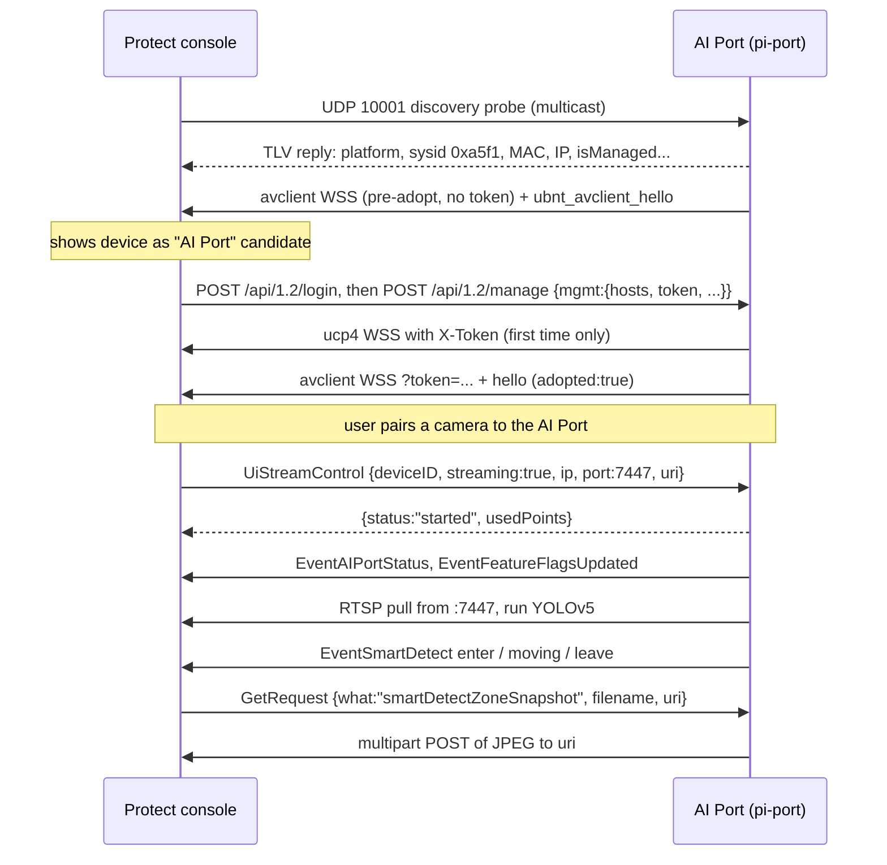

# How an AI Port talks to UniFi Protect

This explains the interface between an AI Port (real or emulated by pi-port) and a
UniFi Protect console: what goes over the wire, in what order, and where each piece
lives in `piport/`. It is written from the code; where the code marks a field as
unconfirmed against a real AI Port, this doc says so. For what the controller does
with each message, see [protect-aiport-controller.md](protect-aiport-controller.md).

An AI Port runs the same firmware middleware as a UniFi camera (`ubnt_ctlserver`,
`ubnt_avclient`). So from the console's side it **adopts like a camera**, then acts
as a **detection co-processor** for other cameras that are paired to it: the console
hands it an RTSP stream, and it pushes smart-detect events back.

## At a glance

| # | Interface | Direction | Transport | Code |
|---|-----------|-----------|-----------|------|
| 1 | UBNT discovery | console → device, reply back | UDP/10001 (multicast `233.89.188.1`) | [discovery.py](../piport/discovery.py) |
| 2 | Device control API | console → device | HTTPS :443 (self-signed) | [http_api.py](../piport/http_api.py) |
| 3 | `ucp4` management channel | device → console | mTLS WebSocket `wss://<console>:7442/`, subprotocol `ucp4` | [ucp4_client.py](../piport/ucp4_client.py) |
| 4 | Classic avclient channel | device → console | mTLS WebSocket `wss://<console>:7442/camera/1.0/ws`, subprotocol `secure_transfer` | [avclient.py](../piport/avclient.py) |
| 5 | Video in | device → console | RTSP `rtsp://<console>:7447/<uri>` (TCP) | `avclient._start_stream` |
| 6 | Snapshot upload / face DB | device → console | HTTPS POST/GET to a URL the console supplies, mTLS | `avclient._upload_snapshot`, `_download_face_db` |

The two WebSockets are both needed. `ucp4` carries management RPCs but the console
only routes camera commands (pairing, streaming, detection) to connections that do
**not** negotiate `ucp4`, so pairing needs the second, classic connection.



## 1. Discovery (UDP/10001)

Classic UBNT L2 discovery. The console scans the multicast group `233.89.188.1:10001`
(not broadcast), so the responder binds `0.0.0.0:10001`, scopes itself to one
interface with `SO_BINDTODEVICE`, and joins the group on that interface.

Request → reply versions: `v1/cmd0 → v1/cmd0`, `v2/cmd8 → v2/cmd6`.

Reply = 4-byte header (`version u8, command u8, length u16 BE`) + TLVs
(`type u8, length u16 BE, value`):

| TLV | Name | Value |
|-----|------|-------|
| `0x02` | IP info | 6-byte MAC + 4-byte IPv4 |
| `0x01` | HW addr | 6-byte MAC |
| `0x0A` | Uptime | u32 BE seconds |
| `0x0B` | Hostname | device name (follows a rename from `ChangeDeviceSettings`) |
| `0x0C` | Platform | must match the console's catalog string (`UVC AI Port`; `discovery_platform` can override with the SKU) |
| `0x17` | Is-managed | u32 BE: `0` when adopted, `1` when not |
| `0x03` | FW version | long discovery string, e.g. `aiport4G.mt8390.v5.1.12.67...` |
| `0x10` | Sysid | **u16 little-endian** `0xa5f1` |
| `0x20` | Device ID | persistent UUID (unique per AI Port) |
| `0x26` | Controller ID | 16 raw bytes of the adopting console's `consoleId`, only once adopted |
| `0x3F` | Supports `ucp4` | `0x01` (gates `needUpdateBeforeAdoption`) |
| `0x2C` | Default credentials | `0x03`, as real cameras send |

Not sent on purpose: `0x05`/`0x14` (duplicates real cameras omit) and `0x2B` GUID
(a console-side field).

Discovery alone is not enough for the console to label the device "AI Port"; it
also needs the unsolicited pre-adopt avclient connection (section 4).

## 2. Device control API (HTTPS :443)

The device's local `ubnt_ctlserver`. The console doesn't validate the certificate;
pi-port generates a self-signed EC P-256 cert on first run (`server.crt`/`server.key`
in the state dir). The **same cert/key is reused as the client cert** for both
outbound WebSockets, and the console pins its fingerprint at adoption.

| Method | Path | Purpose |
|--------|------|---------|
| POST | `/api/1.2/login` | Console logs in first. Any `Set-Cookie` is accepted; no real auth. |
| POST | `/api/1.2/manage` | **Adopt.** Body `{"username","password","mgmt":{...}}`. The `mgmt` object is saved as `adopt_state.json`. |
| GET | `/api/1.2/status` | Camera-style capability blob `{fw, board:{hwaddr}, features:{smartDetect,...}}`. Not the real capability mechanism (see `EventFeatureFlagsUpdated`). |
| GET/POST | `/api/1.2/snapshot`, `/api/snapshot` | Freshest complete JPEG from any paired camera (request has no camera id). 404 if none yet. |
| GET | `/api/info` | Identity: mac, type, sysid, name, firmware, `isAdopted`, `connectionHost`... |
| GET | `/api/support` | `{"statusCode":200}` stub. |
| POST | `/api/adopt`, `/api/readopt` | Legacy paths; accepted but unused by the console. |

Unknown paths get `200 {"statusCode":200}` and are logged.

The `mgmt` adopt payload carries `hosts` (e.g. `["<console>:7442"]`), `token`
(single-use adoption token), `protocol`, `mode`, `nvr`, `controller`, `consoleId`,
`consoleName`, and credentials. `adopt_state.json` is the hand-off point to the other
processes: they poll it, and "adopted" means it has a `token` or `hosts`.

## 3. `ucp4` management WebSocket

Outbound from the device once `adopt_state.json` has `hosts` (or, after 10 s, a
tokenless fallback to `--fallback-host-port`).

**Connection:** `wss://<host>:<port>/`, subprotocol `ucp4`, client cert = device
cert, server cert not verified. Headers:

| Header | Value |
|--------|-------|
| `X-Ident` | MAC, 12 hex, no separators |
| `X-Type` | `UVC AI Port` |
| `X-Mode` | `0` |
| `X-Adopted` | `true` / `false` |
| `X-Ip`, `X-Device-Id`, `X-Version`, `X-Guid` | identity |
| `X-Token` | adoption token — **sent only the first time a token is seen** (tokens are single-use; later reconnects rely on the pinned cert) |

**Framing:** binary frames only. Each message is two records, head then body:

```
record = type u8 | format u8 | compressed u8 | reserved u8 | length u32 BE | payload
type:   1 = head, 2 = body
format: 1 = JSON, 3 = raw bytes (e.g. a JPEG the console checks with Buffer.isBuffer)
```

Head: `{"timestamp": <ms>, "type": "request"|"response", "action": "...", "id": "<uuid>"}`;
responses add `errorCode` and `error`.

**Messages:**

| Action | Who sends | Reply |
|--------|-----------|-------|
| `getConsoleInfo` | device, right after connecting | console's info (logged) |
| `getInfo` | console | `mac, type, fwVersion, version, hwrev:1, adopted, guid, deviceId, ip, connectionHost` (the **console's** host), `connectionSecurePort:443, uptime, upSince, protocolVersion:1, poeType` |
| `networkStatus` | console | `{ip, connected:true}` |
| `changeUserPassword` | console | `{}` (not persisted) |
| `getSnapshot` | console | raw JPEG body (format 3); on failure `errorCode:1` so the console falls back to REST |
| anything else | console | `{}` and logged |

A watcher thread closes the socket whenever the token in `adopt_state.json` changes
(including being cleared), forcing a reconnect with the right `X-Adopted`.

## 4. Classic avclient WebSocket

This is where nearly all AI-Port behaviour lives. It connects **before adoption too**
(to `[console] host`), because that pre-adopt hello is what makes the console show
the device as an AI Port candidate.

**Connection:** `wss://<host>:7442/camera/1.0/ws[?token=<token>]`, subprotocol
`secure_transfer`, same client cert. All headers are required (the console's proxy
closes the connection on an incomplete set):

| Header | Value |
|--------|-------|
| `camera-mac` | MAC, no separators |
| `camera-ip` | device IP |
| `camera-model` | the sysid string `0xa5f1` (**not** `UVC AI Port`) |
| `camera-firmware` | short firmware version |
| `device-id`, `x-guid` | identity |
| `adopted` | `true` / `false` from `adopt_state.json` |
| `Origin` | `http://ws_camera_proto_secure_transfer` |

**Framing:** plain JSON, but sent in **binary** WebSocket frames. Envelope:

```json
{
  "from": "UniFiVideo",
  "to": "ubnt_avclient",
  "functionName": "EventSmartDetect",
  "messageId": 42,
  "timeStamp": "2026-10-16T12:00:00.000000+00:00",
  "payload": { },
  "responseExpected": false,
  "inResponseTo": 0
}
```

`timeStamp` must be an RFC 3339 string (a unix-ms integer is rejected), and
`inResponseTo` must be present on every message (`0` = not a response) or events
are dropped. A reply reuses the request's `functionName` with
`inResponseTo = <request messageId>`.

### 4.1 Hello (device → console, on connect)

`ubnt_avclient_hello`, `responseExpected: true`:

```json
{
  "mac": "fcecda...", "model": "UVC AI Port", "name": "...",
  "fwVersion": "5.1.12.67", "semver": "v5.1.12.67",
  "connectionHost": "<console ip>", "connectionSecurePort": 7442,
  "protocolVersion": 67, "adoptionCode": "<token or null>",
  "ip": "...", "hwrev": 1, "idleTime": 0, "uptime": 123,
  "rebootTimeoutSec": 30, "upgradeTimeoutSec": 150, "totalLoad": 0.1,
  "features": {
    "smartDetect": ["person","vehicle","animal","lineCrossing","liveviewTracking"],
    "motionDetect": ["enhanced"], "privacyMask": true,
    "privacyMasks": {"maxZones": 16, "rectangleOnly": false},
    "squareEventThumbnail": true, "mic": true, "speaker": true, "ledStatus": true
  }
}
```

`connectionHost` must be the **console's** address: Protect builds snapshot-upload
URLs from it, and the device's own IP left paired cameras without thumbnails.
`hwrev` must be non-null or the hardware revision column stays empty.

### 4.2 Console → device functions

| `functionName` | What it means | Device reply / action |
|----------------|---------------|-----------------------|
| `UiStreamControl` | **Pair/unpair a camera.** Payload `deviceID` (paired camera's MAC), `streaming`, `ip`, `port` (7447), `uri`, `width`, `height`, `fps`. | Start/stop the RTSP pull + detector, reply `{"status":"started"|"stopped","usedPoints":N}`. `usedPoints` is the total over active streams, using the real device's per-stream points (2 / 2.5 / 5 / 10 by width × height × fps; see [aiport-firmware-notes.md](aiport-firmware-notes.md#measured-stream-points)). It **must be on every reply**, start and stop, or re-pairing fails with `estimated_capacity_exceeded`. Then sends `EventAIPortStatus` and (on start) `EventFeatureFlagsUpdated`. Re-issues keep existing tracks. |
| `GetStreamList` | Asked on every connect. A non-empty list makes the console send `ResetAIPortStreams` before re-issuing `UiStreamControl`. | `{"list": [{"deviceID", "points"}]}` for each active stream |
| `GetUiStreamPoints` | Cost of proposed streams: `list` of `{deviceID, width, height, fps}`. | `{"list": [{"deviceID", "points"}]}`; invalid entries skipped |
| `ResetAIPortStreams` | Stop every stream (console, firmware ≥ 4.75.6). | Stops all pulls and detectors but keeps track state, since `UiStreamControl` follows straight away; reply `{}` |
| `ChangeVideoSettings` | A query, not a push. | `{video:{video1:{enabled,width,height,fps,bitrate},video2,video3}, audio:{...}}` — `{}` blocks provisioning. |
| `ChangeIspSettings` | Query. | `{irLedMode:"auto", wdr:1}` |
| `ChangeSmartDetectSettings` | Zones for a paired camera: `zones`, `excludeZones`, `lines` (vertices 0–1000), and `eventStartMSec`. | Stored per `deviceID`; detections outside detect zones / inside exclude zones are dropped; lines drive Line Crossing; `eventStartMSec` is how long a new track must be seen before it joins the event (section 5). Per-zone sensitivity isn't applied. |
| `ChangeSmartMotionSettings` | Includes `eventMaxDurationMSec` (default 5 min). | Stored; the device ends long events itself. |
| `GetRequest` (`what` contains `snapshot`) | Fetch a thumbnail named in an earlier event: `filename`, `uri`, `what`, `deviceID`. | Ack `{}`, then upload the JPEG to `uri` (section 6). |
| `UpdateFaceDBRequest` | URL of Protect's known-faces DB. | Ack, download to `<state>/facedb/known.db` (matching not implemented). |
| `ChangeDeviceSettings` | Rename etc. | Persist `name` (so discovery TLV `0x0B` matches); reply `{name, timezone}`. |
| `UpdateFirmwareRequest` | Firmware update with a `uri`. | Never downloads. Sends `EventUpdateFirmwareStatus` `FW_DOWNLOADING` then `FW_UPDATING`, pins the version parsed from the URI, closes the socket (fake reboot); reconnect reports the new version. |
| `UpdateUsernamePassword` | Credential rotation. | `{}` (not persisted). |
| `OnvifStreamControl` | | `{"status":"started"|"stopped"}` |
| `ResetToDefaults` | **Un-adopt.** The console does not close the socket afterwards. | Stop all streams, clear zones, overwrite `adopt_state.json` with `{}`, close; reconnect as unadopted. |
| anything else | | `{}` if `responseExpected` |

### 4.3 Device → console events

**`EventAIPortStatus`** — per paired camera, deduplicated:
`{deviceID, isPlug, isStreaming, isSmartDetectReady, isAudioEventReady}`.
`isSmartDetectReady` appears to gate the console dispatching AI work. pi-port sends it when a stream starts,
then again whenever a camera's health changes: `isStreaming` goes false after 30 s with no frame
from its stream, `isSmartDetectReady` after 30 s with no detection pass (its loop crashed or
hung), and both return to true when it recovers (checked every 5 s, with 30 s of grace after the
stream starts). What Protect's UI does with a false value hasn't been seen yet.

**`EventFeatureFlagsUpdated`** — the real capability mechanism (not `/api/1.2/status`).
The console **replaces** the paired camera's feature flags wholesale with this, so
every key must be present:
`{deviceID, smartDetect:[...], motionDetect:["enhanced"], privacyMask, privacyMasks, squareEventThumbnail, mic, speaker, ledStatus}`.
`smartDetect` gains `licensePlate`, `lprEnhancedByAiKey`, `face`, `faceEnhancedByAiKey`
only when `enrich.py` can produce them. Sent once per camera per connection.

**`EventSmartDetect`** — the detection stream. Shape (zone event):

```json
{
  "deviceID": "AABBCCDDEEFF",
  "clockWall": 1760000000000, "clockMonotonic": 1234, "clockStream": 1234, "clockStreamRate": 1000,
  "edgeType": "enter",
  "eventId": 7,
  "displayTimeoutMSec": 430,
  "objectTypes": ["person"],
  "descriptors": [{
    "trackerID": 3, "objectType": "person", "confidenceLevel": 87,
    "coord": [x, y, w, h],
    "firstShownTimeMs": 1760000000000, "idleSinceTimeMs": 1760000000000,
    "stationary": false, "zones": [1], "lines": [],
    "boxColor": "cyan", "coord3d": [-1, -1], "attributes": null,
    "name": "", "tag": "", "intelligenceZones": [], "loiterZones": [], "secondLensZones": []
  }],
  "zonesStatus": {"1": {"level": 87, "status": "enter"}},
  "smartDetectSnapshotFullFoV": "", "smartDetectSnapshotFullFoVWidth": 0, "smartDetectSnapshotFullFoVHeight": 0,
  "smartDetectSnapshots": []
}
```

Key rules:

- `edgeType` is a state machine: `enter` opens a dashboard event, `moving` updates it,
  `leave` closes it and triggers thumbnail fetches. `none` on its own opens nothing.
- `zonesStatus` mirrors `edgeType` with a non-zero `level`; an empty one stops the
  console recording the object types.
- `zones: [1]` makes it a *zone* event; a line event uses `linesStatus` and `lines`
  instead (see below).
- `coord` is `[x, y, w, h]` on a 0–1000 grid of Protect's **16:9 canvas** the height of
  the video. A non-16:9 camera sits centred in it, so boxes are converted before
  sending (`_to_protect`).
- `clockWall` and the other clocks are the analysed frame's time: each frame is stamped
  when it's read from ffmpeg. `AIPORT_BOX_DELAY_MS` back-dates them further by the
  remaining relay and decode delay so boxes line up with playback.
- Protect keeps **one event per camera**, so all tracks share an `eventId`: `enter` on
  the first confirmed track, one batched `moving` per `AIPORT_TICK_S`, one `leave` when
  the last track ends or `eventMaxDurationMSec` expires.

A `leave` adds thumbnails and final classification:

```json
"trackerIDAttrMap": {"3": {"objectType": "person", "zone": [1]}},
"smartDetectSnapshotFullFoV": "smartdetectsnap_zone_00000012_fullfov.jpg",
"smartDetectSnapshotFullFoVWidth": 1920, "smartDetectSnapshotFullFoVHeight": 1080,
"smartDetectSnapshots": [{
  "trackerID": 3, "smartDetectSnapshotType": "person",
  "smartDetectSnapshot": "smartdetectsnap_zone_31760000000123.jpg",
  "smartDetectSnapshotWidth": 512, "smartDetectSnapshotHeight": 512,
  "coord": [x, y, w, h], "framingRect": [x, y, w, h],
  "clockBestWall": 1760000000123, "clockBestMonotonic": 0,
  "confidenceLevel": 91, "reVerifyEligible": false, "smartDetectSnapshotName": ""
}]
```

The filenames are just keys: the console later asks for each with a `GetRequest`,
and the device maps the name back to the camera and the track's best frame.

Multi-participant leaves send empty `descriptors`, one snapshot per participant, and
richer `trackerIDAttrMap` entries (`faceEmbed`, `associatedFaceTrackerID`,
`vehicleType`, `color`, `matchedName`). If Protect requests none of those snapshots
within 4 s, the device resends a proven single-tracker leave (priority face > person
> vehicle > animal).

**Line Crossing** uses the same envelope with `descriptors[].lines: [<line ref>]`,
`zones: []`, `crosslineA2B`/`crosslineB2A` counters (+ `...Add` deltas), and
`linesStatus: {"<ref>": {level, status, direction, crosslineA2B, crosslineB2A}}`;
its leave's `trackerIDAttrMap` names `line` instead of `zone`. Line events stay per
track. Implemented but not yet verified against a live console.

**`EventUpdateFirmwareStatus`** — `{status: "FW_DOWNLOADING" | "FW_UPDATING"}` during
the faked update.

## 5. Video in (RTSP :7447)

On `UiStreamControl` start, the device pulls `rtsp://<ip>:<port>/<uri>` from the
console's own relay (it never talks to the camera directly). One ffmpeg process per
camera decodes once and splits:

- a full-resolution JPEG written in place to `<stream dir>/<deviceID>.jpg` (every 2 s,
  or every 1 s when plate/face enrichment is on) — the snapshot source;
- 640×640 RGB raw frames to stdout for the detector, at the detection rate.

The stream dir is RAM-backed (`config.stream_dir`) and shared with `http_api.py` and
`ucp4_client.py` for their snapshot endpoints. If ffmpeg dies unexpectedly it restarts
(0.5 s backoff, then 2 s).

Detecting and reporting run at separate rates:

| Knob | Default | What it controls |
|------|---------|------------------|
| `AIPORT_DETECT_FPS` | 10 on macOS; elsewhere one frame per tick | Frames analysed per camera per second. Each frame is analysed once, and tracking runs on every analysed frame. Never slower than reporting. |
| `AIPORT_TICK_S` | 0.33 s on macOS, 1.5 s elsewhere | How often a batched `moving` goes to the console, with every track seen since the last one (a G5 Bullet sends ~every 330 ms). `enter` and `leave` go out as they happen. |
| `eventStartMSec` / `AIPORT_CONFIRM_MS` | Protect's value from `ChangeSmartDetectSettings` (0 until sent) | How long a new track must be seen before it joins the event. A track lost before then is dropped with no event, so one- or two-frame false detections never open a dashboard event. The env var overrides Protect's value. |
| `AIPORT_MISS_S` | 3 s | How long without a detection before a track closes. |

When no track is open, a cheap frame-diff gate (`AIPORT_MOTION_GATE`,
`AIPORT_MOTION_GATE_THRESH`) skips the detector on a static scene. Its reference frame
advances at most once per tick, so slow movement still registers at high detection rates.

## 6. Snapshot upload and face DB (HTTPS to the console)

For `GetRequest`, the device POSTs `multipart/form-data` to the request's `uri`:

- form field `payload`, filename `snapshot.jpg`, `image/jpeg`;
- headers `x-ident` (MAC, upper case), `x-type` (`UVC AI Port`), `x-sysid` (`0xa5f1`);
- client cert = device cert, server cert not verified.

Object snapshots are 512×512 crops around the box (1.6× margin) from the track's
best-scoring frame; `..._fullfov.jpg` names get the whole frame.

`UpdateFaceDBRequest` is a GET to the given `uri` with the same headers and cert.

## Lifecycle and state

1. **Not adopted.** Discovery answers with `isManaged=1`; avclient connects tokenless
   to `[console] host` and sends a hello with `adopted:false`. The console lists an
   "AI Port" to adopt.
2. **Adopt.** Console logs in and POSTs `/api/1.2/manage`; `adopt_state.json` is written.
3. **Connected.** `ucp4` and avclient reconnect to `hosts[0]` with the token (first
   time only); discovery now reports `isManaged=0` and the controller ID.
4. **Pairing.** The user pairs a camera from that camera's settings; the console sends
   `UiStreamControl`, and detection events start flowing.
5. **Un-adopt.** `ResetToDefaults` clears `adopt_state.json`; everything drops back to 1.

All four processes are started together by [run_all.py](../piport/run_all.py) and
share the state dir (`--state-dir`):

| File | Written by | Read by |
|------|------------|---------|
| `adopt_state.json` | `http_api.py` (adopt), `avclient.py` (clear on reset) | all four |
| `server.crt` / `server.key` | `http_api.py` (first run) | HTTPS server; mTLS client cert for both WebSockets and uploads |
| firmware pin (`fw_version.json`) | `avclient.py` on `UpdateFirmwareRequest` | everything that reports a version |
| `device_name` | `avclient.py` on `ChangeDeviceSettings` | discovery, hello |
| `<stream dir>/<deviceID>.jpg` (RAM) | ffmpeg in `avclient.py` | snapshot endpoints and uploads |
| `facedb/known.db` | `avclient.py` | (inspection only) |

Restart all four together: a partial restart leaves stale connections.

## Identity rules

- `platform` / `type` must be exactly `UVC AI Port`; `camera-model` on the avclient
  socket is the sysid string `0xa5f1`.
- `device_id` must be unique and stable per AI Port; changing it makes Protect see a
  new device.
- The MAC defaults to the Ubiquiti OUI `FC:EC:DA` + the interface's last three octets.
- `guid` is a fixed catalog GUID for the AI Port SKU, not per device.

## Confidence

Confirmed live against a real console: discovery, adoption, both WebSockets, pairing,
`EventSmartDetect` zone events with thumbnails, feature-flag propagation, single-
tracker leaves, face events appearing in Protect's faces section.

Best guess / not yet confirmed: Line Crossing shapes, multi-tracker leave shape,
vehicle attribute and plate fields, `ChangeIspSettings` reply, `hwrev` value,
use of Protect's face DB.
